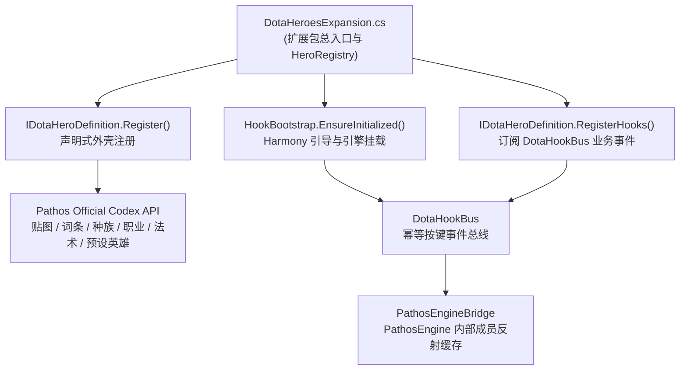
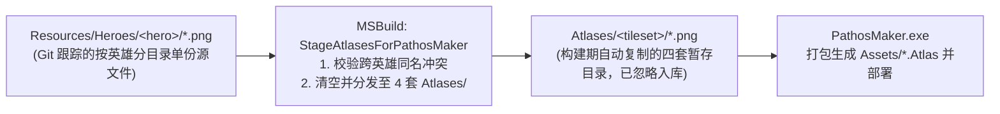

# 整体架构与项目结构

`DotaHeroesExpansion` 采用 **「声明式外壳 + Harmony Hook 核心逻辑」混合架构**，以单 DLL（内嵌 `Lib.Harmony 2.4.3`）形式部署到 Pathos 桌面端（Windows / macOS / Linux）。

## 1. 混合架构分层



- **声明式层（Official Codex API）**：负责贴图（Glyph/Atlas）、多语言词条（Dictionary）、种族、职业、技能外壳、装备与预设英雄注册。
- **运行时 Hook 层（Harmony + `DotaHookBus`）**：负责原生 Codex API 无法声明式表达的 DOTA2 机制（属性守恒与血量联动、实时力敏比缩放、先天技能动态增益、每回合光环/叠层、无敌斩连续瞬移等）。
  - `0Harmony.dll` 作为 `EmbeddedResource` 内嵌进 `DotaHeroesExpansion.dll`，保持单 DLL 零外置依赖。
  - 在 `PathosMaker.exe` 打包期，`HookBootstrap` 会自动识别进程名并跳过 Harmony 补丁，避免干扰图集与词条生成。

---

## 2. 目录结构与职责

```text
pathos-mod/
├── README.md                      # 精简入口与文档导航
├── DotaHeroesExpansion.csproj     # .NET 10 工程文件（内嵌 Harmony、自动聚合贴图、调用 PathosMaker）
├── LocalPathos.props.example      # 本地 Pathos 安装目录模板（复制为 LocalPathos.props，不入库）
├── DotaHeroesExpansion.cs         # 扩展包总入口（初始化 Hook + HeroRegistry 清单）
├── Framework/                     # 英雄扩展公共底座
│   ├── IDotaHeroDefinition.cs     # 英雄定义接口（Register + 可选 RegisterHooks）
│   ├── DotaHeroContext.cs         # Campaign / Codex 常用注册封装
│   └── Hooks/
│       ├── HookBootstrap.cs       # Harmony 引导器与引擎方法挂载
│       ├── DotaHookBus.cs         # 幂等按键事件总线
│       ├── HookEventArgs.cs       # 强类型 Hook 事件上下文
│       └── PathosEngineBridge.cs  # PathosEngine 内部成员反射缓存与安全封装
├── Heroes/                        # 各英雄独立实现（每英雄一个主文件）
│   ├── MorphlingHero.cs
│   └── JuggernautHero.cs
├── Resources/                     # 原始美术/媒体资源（按英雄分目录单份存放，入库）
│   └── Heroes/
│       ├── morphling/             # 变体精灵专属贴图（单份 128x128 PNG）
│       └── juggernaut/            # 主宰专属贴图（单份 128x128 PNG）
├── Atlases/                       # [构建期自动生成，已 .gitignore] PathosMaker 要求的四套扁平贴图目录
├── Assets/                        # PathosMaker 生成的二进制 Atlas 与多语言 Dictionary
└── docs/                          # 项目文档中心
    ├── architecture/              # 架构、Hook 总线与设计规范
    ├── guides/                    # 编译调试与新增英雄指南
    └── heroes/                    # 各英雄详细机制文档
```

---

## 3. 资源按英雄管理与构建聚合流

Pathos 官方打包工具 `PathosMaker.exe` 要求贴图位于项目根目录的扁平路径 `Atlases/<tileset>/<glyphName>.png`。如果直接把所有英雄的图片堆在 `Atlases/` 里，英雄一多极易混淆且难以维护。

本项目通过 MSBuild Target `StageAtlasesForPathosMaker`（位于 [DotaHeroesExpansion.csproj](../../DotaHeroesExpansion.csproj)）解耦**源码存储结构**与**打包工具目录结构**：



- **源码侧**：始终在 `Resources/Heroes/<hero_id>/` 下维护单份贴图（未来若有跨英雄通用资源，可放在 `Resources/Shared/`，构建脚本同样会自动收录），构建期自动分发至 `absurd` / `classic` / `geoduck` / `sonyvanda` 四套图集目录。
- **冲突保护**：如果不同目录下存在同名 PNG，编译阶段会直接报错提示，防止静默覆盖。
- **零冗余提交**：`Atlases/` 已加入 `.gitignore`，仓库中仅保留一份按英雄归档的源文件。
