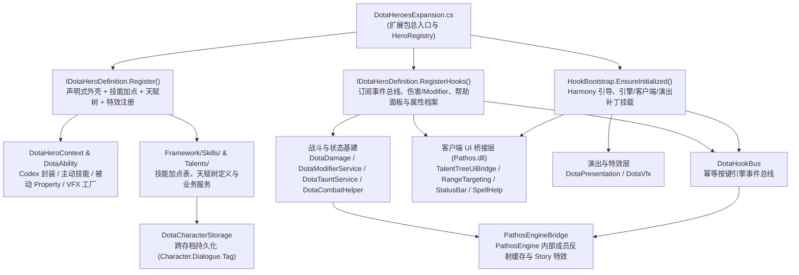
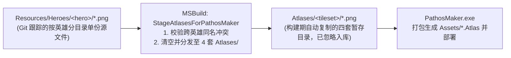

# 整体架构与项目结构

`DotaHeroesExpansion` 采用 **「声明式外壳 + Harmony Hook 核心逻辑 + 客户端原生 UI 桥接」混合架构**，以单 DLL（内嵌 `Lib.Harmony 2.4.3`）形式部署到 Pathos 桌面端（Windows / macOS / Linux）。

## 1. 混合架构分层



- **声明式层（`DotaHeroContext` + `DotaAbility` + `DotaHeroProfile`）**：负责贴图（Glyph/Atlas）、多语言词条（Dictionary）、种族、职业、5 阶法术外壳、先天/被动 Property、自绘像素 VFX（`Explosion` / `Strike` / `Beam`）、装备与预设英雄注册。
- **核心数值与战斗基建层（`DotaMechanicsMapper` / `DotaDamage` / `DotaModifierService` / `DotaTauntService` / `DotaCombatHelper` / `DotaStats` / `DotaLife`）**：提供全局统一的 DOTA2 7.42 → Pathos 换算公式、统一伤害管线（物理/魔法/纯粹、暴击、魔抗）、通用带回合数 Modifier、通用嘲讽、跨存档持久化（`DotaCharacterStorage`）以及敌友判定、驱散与目标解析工具。
- **运行时引擎 Hook 层（`Framework/Hooks/`）**：负责原生 Codex API 无法声明式表达的 DOTA2 机制（属性守恒与血量联动、实时力敏比缩放、先天技能动态增益、每回合光环/叠层、无敌与沉默拦截、变形/模仿等）。
  - `0Harmony.dll` 作为 `EmbeddedResource` 内嵌进 `DotaHeroesExpansion.dll`，保持单 DLL 零外置依赖。
  - 在 `PathosMaker.exe` 打包期，`HookBootstrap` 自动识别进程名并跳过 Harmony 补丁，避免干扰图集与词条生成。
- **客户端 UI 桥接与本地化层（`Framework/Skills/`、`Framework/Talents/`、`Framework/Targeting/`、`Framework/UI/`、`Framework/Localization/`）**：通过共享的 `PathosClientReflection` 挂载 `Pathos.dll` 客户端类，实现「技能与天赋」合并侧边面板（左下角原生按钮 + `F2`）、全射程方格选框、左上角状态栏徽章、技能/被动帮助面板实时数值，以及支持实时切换语言的 25 国运行时 UI 词表（`DotaLocalization`）。
- **演出层（`Framework/Presentation/`）**：`DotaPresentation` 在 `Story.NextTurn`（每帧）上按真实秒数推进技能步骤并可冻结 `Engine.Process`，让连斩/突进/弹道拥有 DOTA2 原版的时长观感；`DotaVfx` 接管 `Animator.Execute`，为自定义特效提供淡入淡出、缩放、旋转与跟随角色。

---

## 2. 目录结构与职责

```text
pathos-mod/
├── AGENTS.md                                  # AI 编程助手入口与开发铁律
├── README.md                                  # 项目入口与文档导航
├── DotaHeroesExpansion.csproj                 # .NET 10 工程文件（内嵌 Harmony/UI 词表、聚合贴图、调用 PathosMaker）
├── LocalPathos.props.example                  # 本地 Pathos 安装目录模板（复制为 LocalPathos.props，不入库）
├── DotaHeroesExpansion.cs                     # 扩展包总入口（初始化 Hook + HeroRegistry 清单）
├── Framework/                                 # 英雄扩展公共基建底座
│   ├── IDotaHeroDefinition.cs                 # 英雄定义接口（Id / Register / RegisterHooks）
│   ├── DotaHeroContext.cs                     # Codex 注册封装（被动 Property / VFX / 预设英雄 / 六维）
│   ├── DotaHeroProfile.cs                     # DOTA2 7.42 Base/Gain 三维 → 初始六维 / 属性上限 / 职业样板
│   ├── DotaMechanicsMapper.cs                 # DOTA2 → Pathos 统一数值换算与固定六维/上限锁定
│   ├── DotaAbility.cs / DotaTable.cs          # 主动技能一次性声明（外壳+选格+分发）与 1 起始数值表
│   ├── DotaDamage.cs                          # 统一伤害管线（物理/魔法/纯粹、暴击、魔抗）
│   ├── DotaModifierService.cs                 # 通用带回合数增益/减益（护甲/移速/攻速/DoT/驱散/徽章，零 Property）
│   ├── DotaTauntService.cs                    # 通用嘲讽状态与行为重定向
│   ├── DotaStats.cs / DotaLife.cs             # 强类型六维读写与最大生命联动
│   ├── DotaCharacterStorage.cs                # 跨存档持久化（技能等级、天赋、自定义整数 → Character.Dialogue.Tag）
│   ├── DotaCharacterFlagSet.cs                # 弱引用角色布尔标记集合
│   ├── DotaCombatHelper.cs                    # 战斗通用工具（敌友判定 / 熟练度 / 驱散 / 选目标 / 返蓝）
│   ├── Hooks/                                 # PathosEngine 运行时 Hook 与反射桥接
│   │   ├── HookBootstrap.cs                   # Harmony 引导器、引擎补丁与客户端 UI / 演出桥接入口
│   │   ├── DotaHookBus.cs                     # 幂等按键事件总线与线程上下文（ActiveSpellCast / ActiveAttack）
│   │   ├── DotaHookHandlerList.cs             # 按 (Priority, 注册顺序) 确定性分发的处理器列表
│   │   ├── HookEventArgs.cs                   # 强类型 Hook 事件上下文
│   │   └── PathosEngineBridge.cs              # 引擎内部成员反射缓存（伤害/治疗/变形/召唤/销毁/Story 特效）
│   ├── Skills/                                # DOTA2 风格技能加点子系统（Q/W/E/R + 7 级黄点）
│   │   ├── HeroSkillDefinitions.cs            # HeroSkillBuild / DotaSkillSlot / DotaSkillStat
│   │   ├── HeroSkillRegistry.cs               # 全局技能加点表索引
│   │   └── HeroSkillService.cs                # 技能点计算、加点升级（学法/原生升星/被动）与存档读写
│   ├── Talents/                               # DOTA2 四层双修天赋树子系统（Lv 10/15/20/25 + Lv 27~30）
│   │   ├── TalentDefinitions.cs               # TalentNode / TalentTier / HeroTalentTree / SpellManaReductionRule
│   │   ├── TalentRegistry.cs                  # 全局天赋树索引
│   │   ├── TalentService.cs                   # 天赋状态查询、不可洗点学习、减冷却→减蓝耗、StatBonus 与升级提示
│   │   └── TalentTreeUiBridge.cs              # 左下角原生 MenuButton + 「技能与天赋」合并侧边面板 + 原生过滤
│   ├── Presentation/                          # 技能演出时间轴与 VFX 样式
│   │   ├── DotaPresentation.cs                # Sequence / Loop / HitStop（真实时间节拍与世界冻结）
│   │   └── DotaVfx.cs                         # 自定义 VFX 渲染样式（淡入淡出/缩放/旋转/跟随角色）与播放 API
│   ├── Targeting/                             # 全射程选格施法子系统
│   │   └── DotaRangeTargetingBridge.cs        # 拦截 DirectQuery 扩展全射程方格选框与点击捕获
│   ├── Localization/                          # 运行时多语言 UI 词表
│   │   └── DotaLocalization.cs                # 嵌入 Resources/Localization/ui.<lang>.json 读取与实时语言回退
│   └── UI/                                    # 客户端共享反射、帮助面板、状态栏徽章与可见性注册表
│       ├── PathosClientReflection.cs          # Pathos.dll 查找、PatchSafe 与 Theme.GetImage 共享封装
│       ├── DotaSpellHelpBridge.cs             # 技能与被动帮助面板（实时数值、真实蓝耗与 5 阶/分级明细）
│       ├── DotaStatusBarBridge.cs             # StagePanel.LeftColumn 左上角状态栏动态徽章
│       └── DotaPropertyVisibility.cs          # 原生天赋栏与百科中需隐藏的短期技能状态注册表
├── Heroes/                                    # 各英雄独立实现（直接接入 Framework 基建）
│   ├── AxeHero.cs
│   ├── JuggernautHero.cs
│   └── MorphlingHero.cs
├── Resources/                                 # 原始美术与本地化资源（入库）
│   ├── Heroes/
│   │   ├── axe/                               # 斧王专属贴图与自绘像素特效（单份 128x128 PNG）
│   │   ├── juggernaut/                        # 主宰专属贴图与自绘像素特效（单份 128x128 PNG）
│   │   └── morphling/                         # 变体精灵专属贴图与自绘像素特效（单份 128x128 PNG）
│   └── Localization/                          # 25 种语言运行时 UI 词表（ui.<lang>.json，嵌入 DLL）
├── tools/VfxGen/                              # 像素 VFX 贴图生成器（不参与扩展编译）
├── Atlases/                                   # [构建期自动生成，已 .gitignore] PathosMaker 四套扁平贴图目录
├── Assets/                                    # PathosMaker 生成的二进制 Atlas 与多语言 Dictionary
└── docs/                                      # 项目文档中心
    ├── architecture/                          # framework-api 速查、整体架构、Hook 总线、天赋与技能、范围选格、数值规范
    ├── guides/                                # 编译调试与新增英雄标准接入指南
    └── heroes/                                # 各英雄详细机制与 7.42 数值溯源文档
```

---

## 3. 资源按英雄管理与构建聚合流

Pathos 官方打包工具 `PathosMaker.exe` 要求贴图位于项目根目录的扁平路径 `Atlases/<tileset>/<glyphName>.png`。本项目通过 MSBuild Target `StageAtlasesForPathosMaker`（位于 [DotaHeroesExpansion.csproj](../../DotaHeroesExpansion.csproj)）解耦**源码存储结构**与**打包工具目录结构**：



- **源码侧**：始终在 `Resources/Heroes/<hero_id>/` 下维护单份贴图（未来若有跨英雄通用资源，可放在 `Resources/Shared/`，构建脚本同样会自动收录），构建期自动分发至 `absurd` / `classic` / `geoduck` / `sonyvanda` 四套图集目录。
- **冲突保护**：如果不同目录下存在同名 PNG，编译阶段会直接报错提示，防止静默覆盖。
- **零冗余提交**：`Atlases/` 已加入 `.gitignore`，仓库中仅保留一份按英雄归档的源文件。
