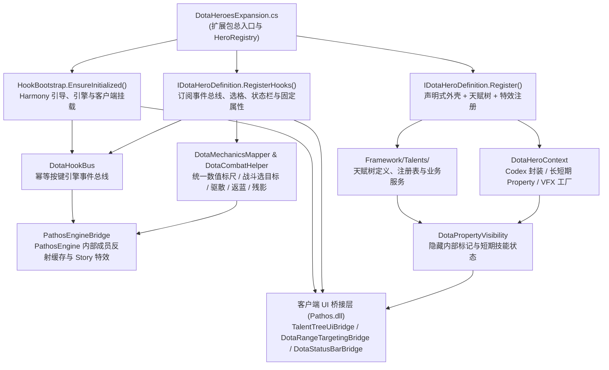
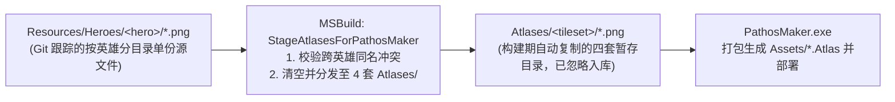

# 整体架构与项目结构

`DotaHeroesExpansion` 采用 **「声明式外壳 + Harmony Hook 核心逻辑 + 客户端原生 UI 桥接」混合架构**，以单 DLL（内嵌 `Lib.Harmony 2.4.3`）形式部署到 Pathos 桌面端（Windows / macOS / Linux）。

## 1. 混合架构分层



- **声明式层（`DotaHeroContext` + Official Codex API）**：负责贴图（Glyph/Atlas）、多语言词条（Dictionary）、种族、职业、技能外壳、长效天赋与短期技能状态 Property、自绘像素 VFX（`Explosion` / `Strike` / `Beam`）、装备与预设英雄注册。
- **核心数值与战斗基建层（`DotaMechanicsMapper` + `DotaCombatHelper`）**：提供全局统一的 DOTA2 7.42 → Pathos 换算公式（属性/蓝量/伤害/时间/护甲/减冷却）以及可复用的敌友判定、熟练度分档、基础驱散、全射程目标解析、空大返蓝与残影绘制工具。
- **运行时引擎 Hook 层（`Framework/Hooks/`）**：负责原生 Codex API 无法声明式表达的 DOTA2 机制（属性守恒与血量联动、实时力敏比缩放、先天技能动态增益、每回合光环/叠层、无敌斩多回合自动连斩等）。
  - `0Harmony.dll` 作为 `EmbeddedResource` 内嵌进 `DotaHeroesExpansion.dll`，保持单 DLL 零外置依赖。
  - 在 `PathosMaker.exe` 打包期，`HookBootstrap` 自动识别进程名并跳过 Harmony 补丁，避免干扰图集与词条生成。
- **客户端 UI 桥接层（`Framework/Talents/`、`Framework/Targeting/`、`Framework/UI/`）**：通过共享的 `PathosClientReflection` 挂载 `Pathos.dll` 客户端类，实现独立天赋树面板（左下角原生按钮 + `F2`）、全射程方格选框、左上角状态栏动态叠层徽章，以及原生天赋栏/百科的短期状态隐藏过滤。
- **演出层（`Framework/Presentation/`）**：`DotaPresentation` 在 `Story.NextTurn`（每帧）上按真实秒数推进技能步骤并可冻结 `Engine.Process`，让连斩/突进/弹道拥有 DOTA2 原版的时长观感；`DotaVfx` 接管 `Animator.Execute`，为自定义特效提供淡入淡出、缩放、旋转与跟随角色。

---

## 2. 目录结构与职责

```text
pathos-mod/
├── README.md                                  # 项目入口与文档导航
├── DotaHeroesExpansion.csproj                 # .NET 10 工程文件（内嵌 Harmony、聚合贴图、调用 PathosMaker）
├── LocalPathos.props.example                  # 本地 Pathos 安装目录模板（复制为 LocalPathos.props，不入库）
├── DotaHeroesExpansion.cs                     # 扩展包总入口（初始化 Hook + HeroRegistry 清单）
├── Framework/                                 # 英雄扩展公共基建底座
│   ├── IDotaHeroDefinition.cs                 # 英雄定义接口（Id / Register / RegisterHooks）
│   ├── DotaHeroContext.cs                     # Codex 注册封装（长短期 Property / VFX / 预设英雄 / 六维）
│   ├── DotaMechanicsMapper.cs                 # DOTA2 → Pathos 统一数值换算与固定六维锁定
│   ├── DotaCombatHelper.cs                    # 战斗通用工具（敌友判定 / 熟练度 / 驱散 / 选目标 / 返蓝 / 残影）
│   ├── Hooks/                                 # PathosEngine 运行时 Hook 与反射桥接
│   │   ├── HookBootstrap.cs                   # Harmony 引导器、14 组引擎补丁与 3 组客户端桥接入口
│   │   ├── DotaHookBus.cs                     # 幂等按键事件总线与线程上下文（ActiveSpellCast / ActiveAttack）
│   │   ├── HookEventArgs.cs                   # 强类型 Hook 事件上下文
│   │   └── PathosEngineBridge.cs              # 引擎内部成员反射缓存（伤害/治疗/召唤/销毁/Story 特效/自动回合）
│   ├── Talents/                               # DOTA2 四层双修天赋树子系统
│   │   ├── TalentDefinitions.cs               # TalentNode / TalentTier / HeroTalentTree / SpellManaReductionRule
│   │   ├── TalentRegistry.cs                  # 全局天赋树索引与 dota_talent_* 持久化标记生成
│   │   ├── TalentService.cs                   # 天赋状态查询、不可洗点学习、减冷却→减蓝耗、升级解锁提示
│   │   └── TalentTreeUiBridge.cs              # 左下角原生 MenuButton + 左侧停靠天赋面板 + 原生面板/百科过滤
│   ├── Presentation/                          # 技能演出时间轴（DotaPresentation：真实时间节拍/世界冻结/顿帧）与 VFX 渲染样式（DotaVfx）
│   ├── Targeting/                             # 全射程选格施法子系统
│   │   └── DotaRangeTargetingBridge.cs        # 拦截 DirectQuery 扩展全射程方格选框与点击捕获
│   └── UI/                                    # 客户端共享反射、状态栏徽章与可见性注册表
│       ├── PathosClientReflection.cs          # Pathos.dll 查找、PatchSafe 与 Theme.GetImage 共享封装
│       ├── DotaPropertyVisibility.cs          # 统一管理原生天赋栏与百科中需隐藏的内部标记及短期技能状态
│       └── DotaStatusBarBridge.cs             # StagePanel.LeftColumn 左上角状态栏动态叠层徽章
├── Heroes/                                    # 各英雄独立实现（直接接入 Framework 基建）
│   ├── MorphlingHero.cs
│   └── JuggernautHero.cs
├── Resources/                                 # 原始美术资源（按英雄分目录单份存放，入库）
│   └── Heroes/
│       ├── morphling/                         # 变体精灵专属贴图（单份 128x128 PNG）
│       └── juggernaut/                        # 主宰专属贴图与自绘像素特效（单份 128x128 PNG）
├── Atlases/                                   # [构建期自动生成，已 .gitignore] PathosMaker 四套扁平贴图目录
├── Assets/                                    # PathosMaker 生成的二进制 Atlas 与多语言 Dictionary
└── docs/                                      # 项目文档中心
    ├── architecture/                          # 整体架构、Hook 总线、天赋与长短期技能、范围选格、数值映射规范
    ├── guides/                                # 编译调试与新增英雄标准接入指南
    └── heroes/                                # 各英雄详细机制与 7.42 数值溯源文档
```

---

## 3. 资源按英雄管理与构建聚合流

Pathos 官方打包工具 `PathosMaker.exe` 要求贴图位于项目根目录的扁平路径 `Atlases/<tileset>/<glyphName>.png`。本项目通过 MSBuild Target `StageAtlasesForPathosMaker`（位于 [DotaHeroesExpansion.csproj](../../DotaHeroesExpansion.csproj)）解耦**源码存储结构**与**打包工具目录结构**：



- **源码侧**：始终在 `Resources/Heroes/<hero_id>/` 下维护单份贴图（未来若有跨英雄通用资源，可放在 `Resources/Shared/`，构建脚本同样会自动收录），构建期自动分发至 `absurd` / `classic` / `geoduck` / `sonyvanda` 四套图集目录。
- **冲突保护**：如果不同目录下存在同名 PNG，编译阶段会直接报错提示，防止静默覆盖。
- **零冗余提交**：`Atlases/` 已加入 `.gitignore`，仓库中仅保留一份按英雄归档的源文件。
