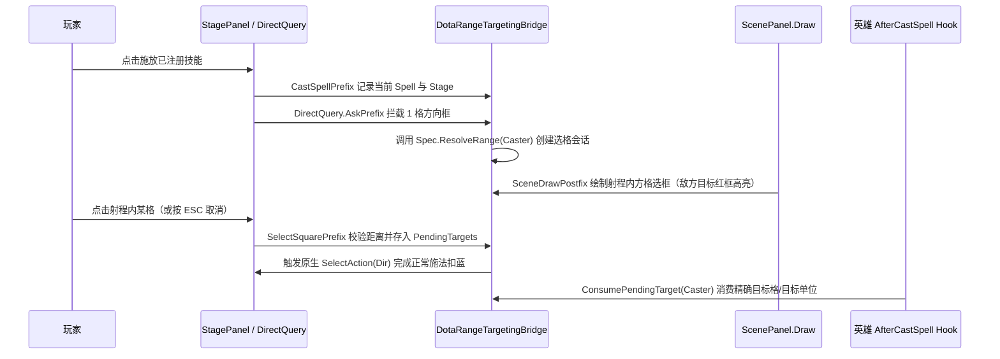

# 全射程选格与范围施法体系

Pathos 原生 `DirectQuery` 仅支持在角色周围 1 格的 8 个方向中选择施法方向，无法直接点选 3~11 格外的具体敌人或空地。本项目通过 [DotaRangeTargetingBridge.cs](../../Framework/Targeting/DotaRangeTargetingBridge.cs) 与 [DotaCombatHelper.cs](../../Framework/DotaCombatHelper.cs) 实现了**原生风格的全射程选格与范围施法基建**。

---

## 1. 全射程选格指示器原理（`DotaRangeTargetingBridge`）

`DotaRangeTargetingBridge` 挂载 `Pathos.dll` 的 5 个客户端方法，完全复用 `Pathos.Theme` 原生配色（`DirectBackgroundBrush` / `HighlightPen` / `HostileBrush` / `HostileTargetPen`）：



- **动态射程**：`ResolveRange` 委托在每次打开选框时实时计算，天然支持随熟练度成长（如无敌斩 4~7 格）及属性/天赋加成（如水人高力量增加施法距离）。
- **10 秒防陈旧超时**：`PendingTargets` 使用 `ConditionalWeakTable<Character, PendingSpellTarget>` 按角色隔离，超过 10 秒未消费自动失效，不会污染后续施法。
- **零入侵取消体验**：按 `ESC` 或点击射程外格子立即取消选格，不扣蓝、不消耗回合。

---

## 2. 注册方式与三种目标模式

在英雄的 `RegisterHooks` 中调用 `DotaRangeTargetingBridge.RegisterSpell(...)` 即可接入：

```csharp
DotaRangeTargetingBridge.RegisterSpell(new DotaRangeSpellSpec(
  SpellName: "omnislash",          // 与 Codex 注册的 Spell.Name 一致（忽略大小写）
  DisplayTitle: "无敌斩",           // 打开选框时头顶飘字提示：无敌斩 (5)
  Mode: DotaTargetMode.UnitHostile, // 目标模式
  ResolveRange: Caster => GetOmnislashCastRange(Ctx, Caster),
  AllowSelf: false));               // 是否允许点击自己脚下格子
```

| `DotaTargetMode` | 视觉高亮行为 | 适用技能类型 |
| :--- | :--- | :--- |
| `UnitHostile` | 射程内普通格显示浅白框，**存在存活敌方单位的格子以红框高亮**（复用 `HostileBrush` / `HostileTargetPen`） | 指向性敌方技能（无敌斩、变体打击、变形） |
| `PointOpen` | 射程内可通行格显示浅白选框 | 点地闪烁 / 点地召唤（波浪形态、治疗守卫） |
| `PointAny` | 射程内所有非阻挡格显示浅白选框 | 任意点地 AOE 技能（如光击阵、陨石等） |

> **声明式外壳前置条件**：要让 Pathos 客户端在施法时弹出 `DirectQuery.Ask` 从而被 `DotaRangeTargetingBridge` 拦截，技能的声明式 `Cast` **不能仅设 `SetTargetSelf(true)`**，必须配置带射程的定向施法（如 `Adept.SetCast().Plain(Dice.Fixed(Range))` 或 `Explosion(...)`）。如果同时允许对自己脚下施放（如治疗守卫），可链式调用 `.Plain(Dice.Fixed(Range)).SetTargetSelf(true)` 并设 `AllowSelf: true`。

---

## 3. 目标消费与标准解析（`DotaCombatHelper`）

在英雄的 `AfterCastSpell` Hook 中，先调用 `DotaRangeTargetingBridge.ConsumePendingTarget(Caster)` 取出玩家点击结果，再按技能类型调用 `DotaCombatHelper` 标准解析器：

### 3.1 指向性敌方技能（`UnitHostile`）
```csharp
var Pending = DotaRangeTargetingBridge.ConsumePendingTarget(Caster);
var Target = DotaCombatHelper.ResolveHostileTarget(Caster, Args.Direction, CastRange, Pending);
if (Target == null)
{
  // 空大保护：按实际折后蓝耗返还法力
  DotaCombatHelper.RefundMana(Caster, ActualManaCost);
  return;
}
```
`ResolveHostileTarget` 自动执行四级解析，手感极佳：
1. 玩家直接点击到射程内敌方单位 → 精确命中；
2. 玩家误点到敌人身旁 1 格 → 自动智能吸附该格周围 1 格内最近敌方单位；
3. 未经选格（如宏/快捷键/AI 施法）→ 沿施法方向直线射线搜索首个敌方单位；
4. 直线未命中 → 回退搜索射程内最近敌方单位。

### 3.2 点地召唤 / 点地位移（`PointOpen`）
```csharp
var Pending = DotaRangeTargetingBridge.ConsumePendingTarget(Caster);
var PlacementSq = DotaCombatHelper.ResolveOpenPointTarget(Caster, Args.Direction, Pending);
```
`ResolveOpenPointTarget` 优先使用玩家点击格；若被占据或不可站立，自动在点击格周围 1 格或施法者周围 1 格寻找最近空位。

### 3.3 关键避坑：点地召唤技能禁止在声明式 `Plain` 射线上直接挂 `SummonEntity`
Pathos 原生 `Cast.Plain(Range)` 会沿射线上的**每一个空格**都执行一次 `Apply` 效果。如果在声明式壳子里同时写 `Plain(Range)` 和 `Apply.SummonEntity(...)`，施法一次会瞬间召出 3~5 个召唤物！

**正确模式**（参考主宰「治疗守卫」）：
1. 声明式外壳仅保留 `Adept.SetCast().Plain(Dice.Fixed(Range)).SetTargetSelf(true);` + `Adept.Apply.Nothing();`（只为触发全射程选格与原生扣蓝）。
2. 在 `AfterCastSpell` 中通过 `ResolveOpenPointTarget` 获取落点，调用 **`PathosEngineBridge.SummonAllyEntity(Args.Engine, Caster, PlacementSq, Entity)`** 精确召唤 1 个随从。

---

## 4. 范围 AOE 与动态施法距离

- **方形范围判定（切比雪夫距离）**：Pathos 地图网格使用 `Square.GetAroundSquares(radius)` 与 `Square.AsRange(other)`：
  - `radius = 1` → 周围 `3×3`（8 格，如主宰「剑刃风暴」）。
  - `radius = 2` → 周围 `5×5`（24 格，如主宰「治疗守卫」光环）。
  - `radius = 3` → 周围 `7×7`（如主宰「无敌斩」跳斩搜敌半径）。
- **全局动态施法距离加成**：
  - 引擎侧通过 `DotaHookBus.RegisterCastRange`（Hook `Engine.CastEffects`）动态修改 `Cast.RangeDice` 并在 Postfix 恢复原值。
  - 若某英雄同时使用了 `DotaRangeTargetingBridge`，只需在 `ResolveRange` 回调中也加上相同距离加成（参考水人 `GetStrRangeBonus`），即可让**选框可视化射程**与**引擎实际生效射程**保持 100% 一致。
